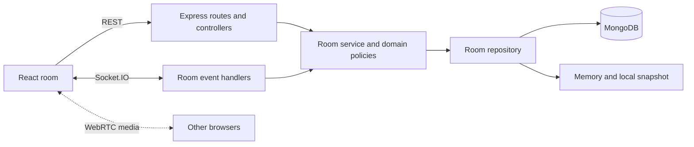

# Watch Party architecture

## System boundaries

The React frontend serves the home screen, room, and admin panel as lazy-loaded views. Within a room, player, chat, music, participants, and waiting-for-approval are feature modules. Shared UI, transport clients, and browser hooks remain in their existing directories. This lets the room compose features without declaring a new global state store.

HTTP routes handle creation, joining, settings, uploads, video links, and admin actions. Express middleware applies cross-cutting policies such as CORS and rate limiting. Controllers translate domain outcomes into existing HTTP responses. Socket handlers manage admission, media signaling, playback synchronization, chat, and music. The server publishes the REST contract at `/api/docs/json` and serves Swagger at `/api/docs`.

## Main flows

- **Admission and permissions.** A room's creator receives a leader secret. Protected room operations resolve the caller and check leader or moderator permissions through `domain/auth-policy.ts`. Approval-required rooms distinguish pending users from admitted members. Admin REST routes separately require `ADMIN_TOKEN`.
- **Playback.** Each browser loads the current room video. Socket.IO distributes play, pause, and seek actions. The client and server use playback snapshots and heartbeats to place joining participants on the common timeline.
- **Chat and music.** Socket handlers validate the sender's room membership and room permissions. Chat supports replies and own-message edits. YouTube search returns candidates for the existing queue, which supports moderation and approval. The queue and main room video have distinct state. A moderator can explicitly place a video on the main screen.
- **Microphone and camera.** Socket.IO relays WebRTC signaling between admitted members of the same room. Peers transmit media directly when possible. A configured TURN relay can carry traffic when a direct route is unavailable. Device previews run in the browser and do not publish tracks to the room.
- **Demo mode.** The backend enforces the demo room and membership caps, and disables uploads for demo rooms. The frontend setting controls the corresponding presentation.

## Persistence

`RoomService` uses the room repository port. By default the routing adapter selects Mongoose when connected, otherwise it uses the in-memory adapter. `ROOM_STORE=prisma` selects the optional Prisma adapter for MongoDB and has the same memory fallback. Mongo-backed adapters use a unique room identifier. The memory adapter uses a local file snapshot, whose durability depends on the host filesystem. Active sockets, join grace timers, and rate limits are process-local state. The repository has no Valkey integration or external cache to configure.

The repository boundary keeps the storage choice out of controllers and socket handlers. Adding a storage provider would change the adapter and deployment assumptions, so the current refactor preserves the existing options.

## External integrations

Browser-hosted rooms are an optional creation mode under `features/host-room`. A PeerJS data mesh carries room snapshots and WebRTC signaling independently of Render. The creator initially owns a stable room directory ID on PeerServer. Remaining members attempt to claim that ID after the host stops responding, so the original private invitation continues to locate the successor. The signaling server arbitrates ownership of that ID. A signaling outage can delay election and new admissions.

The current host authorizes state changes. Members can send chat messages and edit their own messages, while playback, video selection, and server settings are host operations. HMAC proofs bind each admission handshake to both transport endpoints and the member identity, so the invitation secret is not sent in the greeting. Snapshots carry up to 300 messages, member state, settings, and the latest playback checkpoint. Pending chat messages retry with stable identifiers after host transfer. Complete local file replicas carry a SHA-256 digest and are reusable after host migration. Transfers use small blocks with backpressure and a 256 MB per-file limit. Rooms currently support eight participants. An interrupted transfer without another complete copy cannot recover the original file.

Microphone and camera tracks retain the existing WebRTC lifecycle through a small transport interface. Already connected participants keep their direct media paths during host transfer. Local device previews use the existing device settings component. YouTube and direct HTTPS video URLs play from the provider in each browser. Direct sources requiring the backend CORS proxy should use external-server mode.

The host mode uses browser memory. It ends when the last member leaves and does not provide the backend admin or persistent-storage workflows. Render rooms retain their existing server workflow. Switching the creation selector chooses the transport for a new room. Live conversion of an existing Render room into a browser room is not implemented.

The music panel uses the YouTube Data API through the backend when enabled. The backend also retains Spotify resolver, search, and server-side OAuth routes. Spotify connection state is tied to the room, OAuth state is single-use, and persistent tokens require the configured encryption key. The old per-user Spotify documentation reflects historical UI behavior.

## Contract references

The source of truth for event payloads is the matching client emitter and server handler. The older [event inventory](architecture/SOCKET_EVENTS.md), [flow diagrams](architecture/SEQUENCES.md), and [cinematic behavior notes](interstellar-cinematic.md) are useful references when tracing a workflow. Confirm their examples against the current handlers.
